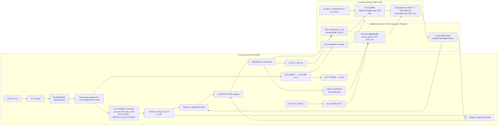

# Stage 1 — Architecture and isolation

Status: **proposal for Stage 1 review** (issue #1). Nothing here is in the KiCad files yet.

## 1. Requirement and what it implies

All low-voltage (LV) control electronics and control signals are galvanically isolated from the HV
power path, and the regulator that powers the control side is isolated (user decision, Stage 1).

A buck converter shares VIN− and VOUT−, so the 72 V → 24 V power path itself cannot be isolated.
The barrier therefore sits **between the power stage (with everything referenced to it) and the
control electronics**:

| Domain | Reference / rail | Contents |
|---|---|---|
| **HV power domain** | `PGND` (= VIN− = VOUT−), `+5V_PWR` (5.2 V) | Input connector, fuse, TVS, reverse-polarity FET, hot-swap, bulk/HF caps, EPC2304s, coupled inductor, phase shunts, output caps and terminals; *output* side of the gate drivers, bootstrap; *input* side of the isolated amplifiers; INA301 fast OCP comparators; OTP comparator and NTC; 5 V buck (LM5012); fan switch and fan connector; *input* of the isolated DC-DC |
| **LV control domain** | `GND_ISO`, `+5V_ISO` | LTC3861 controller, compensation/soft-start, cycle-by-cycle latches, fault latch, output-OVP comparator, PGOOD/FAULT LEDs, rack signal connector J4 (EN in, PGOOD/FAULT out); *input* side of the gate drivers; *output* side of the isolated amplifiers and digital isolators; *output* of the isolated DC-DC |

### Why the LTC7890 was dropped
The LTC7890's gate drivers, current-sense inputs and VIN pin all sit on power ground, so the controller
can't be on the isolated side. It was replaced by an LV-side controller with logic PWM outputs plus
isolated half-bridge GaN drivers.

### Why a voltage-mode controller (and 250 kHz)
Only slow signals cross the barrier cleanly: VOUT feedback and the current-share signals, through
isolated ΔΣ amplifiers with about 334 kHz bandwidth and a few µs of delay. Peak-current-mode control
needs a cycle-accurate current signal on the controller side, which those amplifiers can't provide.
Voltage-mode control with a slow current-sharing loop fits. **ADI LTC3861** is that controller, but its
minimum frequency is 250 kHz, so the per-phase frequency moves **200 → 250 kHz** (user approved,
Stage 1). The fast per-phase current limit stays local on the HV side (§4).

## 2. Block diagram



## 3. Signals that cross the barrier (complete list)

| # | Signal | Direction | Part | Notes |
|---|---|---|---|---|
| 1 | PWM1 → Q3 (HS) / Q4 (LS) | LV → HV | U1 Si8274GB1-IS1 | One PWM input, built-in dead time (10–200 ns via R_DT), overlap protection, 3 V output UVLO, 2.5 kVrms, 200 kV/µs CMTI. HS output floats on SW1 from the bootstrap. |
| 2 | PWM2 → Q5 / Q6 | LV → HV | U2 Si8274GB1-IS1 | As above |
| 3 | Driver disable | LV side pin | U1/U2 ENABLE | Driven by LTC3861 PWMEN1/PWMEN2 (low when PWM is three-stated: RUN low, hiccup, start-up). 10 kΩ pull-downs R94/R95 |
| 4 | I1 (shunt RS2 at 24 V CM) | HV → LV | U6 AMC3301 | ±250 mV in, gain 8.2, 334 kHz BW, built-in isolated DC-DC (no floating supply). 4.25 kVrms reinforced. Feeds LTC3861 ISNS1 (current sharing + average OCP) |
| 5 | I2 (RS3) | HV → LV | U7 AMC3301 | Same, ISNS2 |
| 6 | VOUT (divider 1/30) | HV → LV | U8 AMC3330 | ±1 V in, gain 2, ±0.2 % gain error, built-in isolated DC-DC. Feeds LTC3861 VSNSP/N and output OVP |
| 7 | OCP1 alert (INA301) | HV → LV | AT1 ch A (SI86S620BC) | Cycle-by-cycle limit, about 1 µs response |
| 8 | OCP2 alert | HV → LV | AT1 ch B | |
| 9 | OTP (80 °C) | HV → LV | AT2 ch A | Latches on the LV side |
| 10 | Hot-swap bus good (LM5069 PGD) | HV → LV | AT2 ch B | Holds RUN_OK low until VBUS is fully charged, so switching never starts during inrush. Fan tach stays on the HV side (TP14) |
| 11 | Power | HV → LV | PS1 | Isolated 5 V module from `+5V_PWR` (§5) |

No other copper crosses the barrier. The SI86S620BC is 2 forward / 0 reverse channels, so both AT1 and
AT2 sit with side 1 on HV and side 2 on LV. Nothing needs to go LV → HV except PWM, which travels
inside U1/U2.

Not crossing on purpose:
- **Input UVLO/OVP:** the LM5069 handles these on the HV side by disconnecting the input. The LV rail
  then collapses (it is powered from the input), so the controller restarts from soft-start.
- **VIN feed-forward (LTC3861 VINSNS):** tied to a fixed LV-side voltage. Without feed-forward the
  modulator gain changes ±10 % over 64.8–79.2 V, which the compensation absorbs (Stage 2).

## 4. Protection and fault logic

```
HV side (fast, local)                        LV side (decisions)
INA301 OCPx (36 A peak, <1 µs) ──AT1──► cycle latch x (74LVC1G74: set by PWMx rising edge,
                                                         cleared by OCPx) ─► AND (74LVC1G08) with PWMx ─► Si8274 PWM
NTC + TLV3012 (80 °C) ───────────AT2──► ┐
AMC3330 → LTC3861 VSNSOUT → TLV3012 (27 V) ┤─► FAULT latch (74LVC1G74, POR-cleared) ─► RUN1/RUN2 low,
                                         ┘                                             PWMEN low -> Si8274 ENABLE low, FAULT LED/J4
LTC3861 average OC (28 A/phase via AMC3301, 128-cycle counter) ─► 3-state PWM, 131 ms hiccup, auto-retry
LM5069: UVLO 62/60 V, OVLO driven by U22 TLV3012 (82 V), inrush/power limit, 27.5 A current limit, 53 A circuit breaker (auto-retry, -2)
```

- **Cycle-by-cycle per phase:** forcing PWM low ends the high-side on-time and turns the low-side
  FET on, which is the normal buck turn-off. The latch re-arms on the next PWM rising edge.
- **Hiccup:** the LTC3861 three-states PWM after 128 consecutive over-current cycles, resets soft-start
  and waits 32 768 cycles (131 ms at 250 kHz) before retrying (datasheet, Operation section).
- **Latch-off (output OVP, OTP):** the fault latch is cleared only by its power-on reset. That happens
  when input power is cycled, because `+5V_ISO` comes from the input through LM5012 → PS1.
- **Shoot-through:** prevented by Si8274 overlap protection plus dead time. A real shoot-through
  current doesn't flow through the output shunts, so it's backed up by the LM5069 53 A circuit breaker
  (fast gate pull-down) and F1.
- **One common fault line:** `RUN_OK` (diode wired-AND, pull-up R87) holds LTC3861 RUN1/RUN2 low.
  The controller then three-states PWM and drops PWMEN, which disables both Si8274 drivers. Sources:
  fault latch (D15), hot-swap bus not good (D16), J4 EN low (R88).
  LTC3861 PGOOD drives the PGOOD LED and the J4 PGOOD output.

## 5. Power-up sequence

1. Plug-in: D6 and the bulk capacitor ESR damp cable ringing. Q2's body diode conducts forward (it
   blocks if polarity is reversed). The LM5069 holds Q1 off until VIN > 62.3 V, then ramps the bus
   under power limiting.
2. U11 LM5012 starts from the input (before Q1, after Q2) → `+5V_PWR`. The VOM1271 LED is fed from
   `+5V_PWR`, so Q2 turns on and bypasses its body diode.
3. `+5V_PWR` → PS1 → `+5V_ISO`. The AMC parts settle in about 1.4 ms. The fault latch POR releases.
4. EN (J4) high and `RUN_OK` → LTC3861 soft-start (TRACK/SS capacitor). PGOOD goes high in regulation.

Reverse polarity: Q2 stays off (no `+5V_PWR`, so no LED drive), its body diode blocks, and the
bidirectional TVS doesn't conduct. Nothing downstream sees a negative voltage.

## 6. Barrier dimensions (PCB)

- Working voltage across the barrier: at most about 80 V DC, if the host ties `GND_ISO` to its ground
  and that ground is common with DC−.
- IEC 60664-1 / IEC 62368-1 basic insulation, PD2, material group IIIb, ≤ 100 V: about 1.4 mm creepage.
  **Proposed: 2.5 mm minimum keep-out on every layer.** Every bridging part has a larger body creepage
  (SOIC-8/16 NB about 4 mm, SO-MOD 8 mm), so the barrier fits under all of them. A milled slot is
  optional; it isn't needed at this voltage.
- L2 (and L3) are split into a `PGND` region under the power stage and a `GND_ISO` island under the
  controls, with the gap aligned to the barrier.
- Isolation rating of each bridging part: Si8274 2.5 kVrms (UL1577, 62368-1 basic); AMC3301/AMC3330
  4.25 kVrms reinforced; SI86S620BC basic class; NME1S0505SC 1 kVDC functional.
  All are far above the 80 V working voltage.

## 7. What changes in the BOM (summary; details in `parts_stage1.md`)

| Change | Reason |
|---|---|
| 1EDN7550 ×4 (U1–U4) → **Si8274GB1-IS1 ×2** | Isolated half-bridge driver with dead time; no 1EDN common-mode limit at 79 V |
| SS110HL ×4 → ×2 (high-side bootstrap only) + 5.1 V Zener clamp on each bootstrap | Si8274 low side is supplied directly; the Zener stops bootstrap over-charge during GaN reverse conduction (EPC2304 VGS ≤ 6 V) |
| AT1/AT2 SI86S620BC kept, new role | HV → LV flags: OCP1, OCP2 (AT1); OTP, bus-good (AT2) |
| PS1 NME1S0505SC kept as the isolated control supply (Stage 1 review) | Runs at 65 % (typ) to 88 % (max) load; output voltage checked in Stage 2 |
| New: LTC3861, AMC3301 ×2, AMC3330, INA301A3 ×2, LM5012, LM5069-2, VOM1271, logic, TPS2553 | See parts list |
