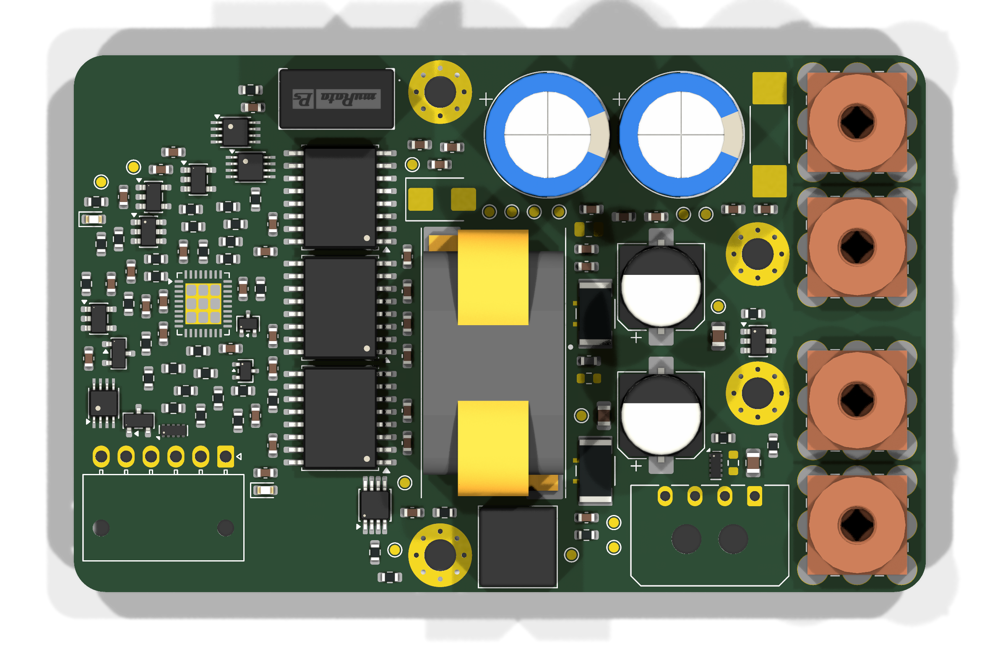
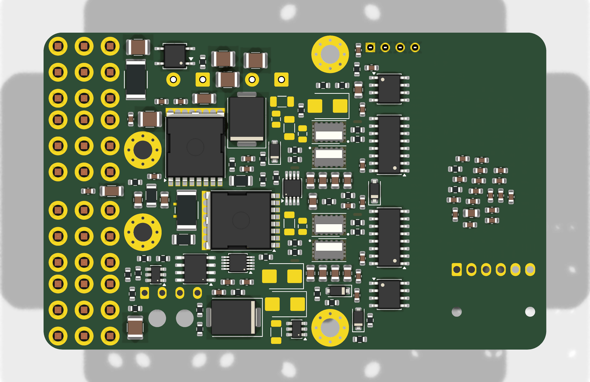
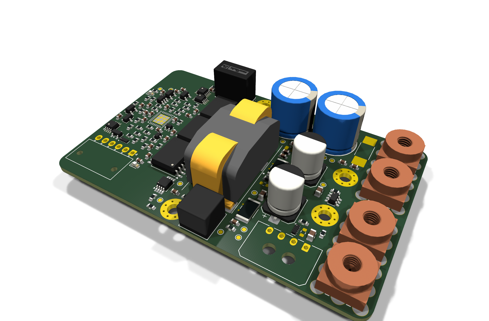

# Stage 3 — Footprints and placement (issue #3)

Board: `kicad/ECE533_Guide/ECE533_Guide.kicad_pcb`, generated by `kicad/tools/build_pcb.py` from
the schematic netlist (first pass). **From here on, placement is edited in KiCad;** the script is the
record of how the first pass was built. Rules: `ECE533_Guide.kicad_dru` (JLCPCB 4-layer, 2 oz).

Placement-only drawings with every reference designator (Fab layers, courtyards, heatsink and barrier):
[top](img/stage3_placement_top.svg), [bottom, mirrored](img/stage3_placement_bottom.svg).

## 1. Footprints

| Part | Footprint | Source | 3D model | Check |
|---|---|---|---|---|
| EPC2304 (Q3–Q6) | `ECE533_Mods:EPC2304_QFN-7_3x5mm` | Drawn from the EPC datasheet pp. 12–13: copper = copper drawing, mask openings = solder-mask-defined land pattern, paste = stencil drawing | SamacSys STEP, rotate z +90° | Rendered from below through a board cut-out: strips, tabs and gate notch on the pads; pin-1 dot over the gate. The SamacSys footprint (15 pads) was wrong and is not used |
| ERUC23-3R2K (L1) | `ECE533_Mods:TDK_ERUC23` | TDK "Recommended PCB layout": 3.7 × 3.7 mm pads, columns 4 / 1 / 3 / 2 at 7.9 mm pitch, 14 mm rows | TDK official STEP, flip about x, offset (0, 6.865, 7.2) | Feet land on pads 4/1/3/2. SamacSys pads did not match TDK |
| CSS2H-2512 shunts (RS1–RS3) | `ECE533_Mods:R_2512_Kelvin` | Bourns pad layout (1.80 × 3.40 mm, 3.40 mm gap) + sense strips, net-tie groups (1,2) (3,4) | KiCad R_2512 | Pin-to-pad check |
| CSS2H-2512C-000 link (R96) | `ECE533_Mods:R_2512_CSS2H` | Same pads without sense strips | KiCad R_2512 | |
| NANO2 456 (F1, DNP) | `ECE533_Mods:Fuse_Littelfuse_NANO2_456` | Littelfuse 20/25/30 A pad layout (3.25 × 3.43 mm, 6.10 mm gap) | Placeholder STEP (boxes) generated by `gen_footprints.py` | |
| REDCUBE 74650194R (J1–J3, J6) | `ECE533_Vendor:Wurth_REDCUBE_74650194` | Würth official KiCad library | Würth STEP | 8.87 mm hole pattern, Ø1.85 mm drill vs datasheet |
| NME1S0505SC (PS1) | `ECE533_Vendor:Murata_NME1S_SIP-4` | SamacSys, converted to the current format | SamacSys STEP | Body on outline, pin 1 on the square pad |

`ECE533_Vendor` and every vendor STEP stay in the git-ignored `kicad/lib/vendor/` (license).
Setup on a new machine: `kicad/lib/vendor/README.md`. `kicad/tools/check_footprints.py` checks every
symbol pin against its footprint pads: **273/273 match**.

Fixes found while doing this:
- **D15/D16 (BAT54W)** had a SOD-323 footprint, but the part is SOT-323 (cathode on pin 3), so pin 3
  had no pad. Changed to `SOT-323_SC-70`.
- **F1:** see §6.
- **Test points:** changed from 1.5 mm to 1.0 mm pads. All 16 must be on top (the heatsink covers the
  bottom), and the 1.5 mm ones didn't fit.

## 2. Floor plan (top view, x from the left edge, y from the top edge)

| Zone | Where | What |
|---|---|---|
| LV control domain | x 0–25.45 | LTC3861, fault logic, J4 rack I/O (bottom-left edge), LEDs, LV side of every isolator |
| Isolation barrier | x 25.45–28.05, full height, all layers | Rule area: no tracks, vias or copper fills. Isolators sit on it with their pins outside it: PS1, U8, U6, U7 on top; AT1, U1, U2, AT2 on the bottom |
| Power stage | bottom, x ≈ 31–43 | Two identical half-bridges at y = 19.1 and 34.9 mm, directly under L1's switch-node pads |
| L1 | top, centre (42.15, 30.95) | Long axis along y; SW pads (3, 4) face the half-bridges, VOUT pads (1, 2) face the output |
| Input bulk | top, upper middle | C5, C6 (EGXF, THT) next to the high-side VBUS rows |
| Input protection | bottom right, under the heatsink | Q1 hot-swap, Q2 reverse FET (TOLL), RS1, D6, LM5069, VOM1271, R96; F1 (DNP) on top above R96 |
| Output | top, right of L1 | RS2/RS3 vertical at the L1 output pads, C66/C67, C60–C65, then the VOUT terminals |
| Terminals | right edge, top side | J1 DC+, J3 DC−, J6 VOUT−, J2 VOUT+ (REDCUBE M4). The 14 mm strip at the right edge is kept clear for ring lugs |
| Aux supply / fan | L2 on top below L1, LM5012 and D5 on the bottom; J5 fan header at the bottom edge |
| Heatsink screws | H1 (36.8, 3.7), H2 (36.8, 50.28), H3 (68.7, 20.0), H4 (68.7, 34.0) | Plated, net HS_SHIELD; all on the HV side |

## 3. Half-bridge arrangement (per phase, bottom side)

- **Low side on top, high side below, stacked 4.3 mm apart.** The high-side source strips line up
  with the low-side drain strips, so the switch node is the 0.7 mm gap between the two FETs on L4.
  There is no switch-node copper on any other layer except the vias up to the L1 pad, which sits
  directly above.
- **Input ceramics:** four 2.2 µF caps in a row under the high side, VBUS pad toward the FET. The
  loop is cap → HS drain strips → SW gap → LS source strips → vias → L3 (PGND, 0.1 mm above L4) →
  back to the caps' PGND pads. That is the vertical loop over the adjacent plane the report asked for.
- **Driver:** the Si8274 sits on the barrier column, 4 mm from the FETs. Mounted on the bottom it is
  mirrored, so channel B (low side) comes out at the top of its output row and channel A (high side)
  at the bottom. The stack order follows that.
  - **Trade-off:** with the strips aligned (which keeps SW on L4 only), the two gate pads end up at
    opposite ends of the pair. The **low-side gate faces the driver**: R13/R14 and the 51 kΩ
    pull-down sit in line, a loop of about 4 mm, chosen to protect against Miller-induced turn-on.
  - **The high-side gate is at the far end.** R15/R16, R1/R3 and NT1/NT3 sit there, and VOA needs
    about 10 mm with its SW_K return, routed as a pair (an inner-layer hop under the caps' PGND
    side).
  - **Alternative if you prefer:** mount the drivers on top, above the stack (the barrier column on
    top is full, so this needs a column redesign), or accept SW copper on L3.
- **On the driver pins:** VDDB decoupling (C8/C10) at the channel-B pins, bootstrap C7/C9 at the
  channel-A pins.
- **Elsewhere:** RT1 (OTP NTC) between the phases under the heatsink; the RC snubbers and SMBJ clamps
  were placed automatically beside the stack.

## 4. Heatsink, height and mechanics
- **Heatsink:** Z60-12.7B on the bottom at x 25.6–85.6 (flush with the right edge), 3 mm overhang
  top and bottom.
- **Fan:** the duct and fan sit beyond the right end (outlines on User.Drawings).
- **Pedestal:** now **3.0 mm** (Stage 1 said about 2.5 mm). Bottom parts under the heatsink are
  limited to 3 mm: TOLL 2.3, SMC 2.6, SOIC 1.75. The thermal cost of the extra 0.5 mm of pedestal is
  under 0.05 °C/W. Pedestal outlines over each FET pair are on B.Fab.
- **Bottom-side parts:** 134 parts on the bottom, all low parts. Nothing tall (L1, L2, C5, C6,
  C66/C67, connectors, PS1, test points, LEDs) is on the bottom.

## 5. Board set-up and DRC
- **Outline:** ID-1, 85.60 × 53.98 mm, R3.18 corners.
- **Stack-up:** written into the board: 4 × 70 µm copper, 3313 prepreg 0.0994 mm, core 1.10 mm,
  1.60 mm total, ENIG (fine-pitch EPC pads need a flat finish).
- **Layer names:** L1_Top / L2_PGND / L3_Power / L4_Bottom.
- **Net classes:**
  - `LV_ISO`: every net on the control side (generated from the netlist).
  - `HV_SW`: VBUS, SW1, SW2.
- **Rules (`ECE533_Guide.kicad_dru`):**
  - JLC 2 oz minimums: 0.15 mm track/space, via 0.2 mm drill with 0.15 mm annular ring, PTH annular
    ring 0.2 mm, hole-to-hole 0.5 mm, hole-to-copper 0.25 mm, edge 0.3 mm.
  - 0.25 mm for HV_SW against other parts.
  - **2.5 mm between LV_ISO and everything else** (the isolation barrier).
- **DRC (with schematic parity):** 0 errors, 0 footprint/parity issues. What remains:
  - 499 unconnected items (nothing is routed yet; Stage 4).
  - 1 warning: the stock LTC3861 QFN pin-1 marker is clipped by a neighbouring pad's mask.
- **ERC:** 0 violations.

## 6. Decisions made in Stage 3
| Decision | Reason |
|---|---|
| F1 becomes a not-fitted option; R96 (CSS2H-2512C-000, < 0.1 mΩ, 100 A) is the input link | 0456025.ER is rated 72 VDC (< 79.2 V); no ≥ 25 A SMD fuse rated ≥ 100 VDC found. The LM5069 circuit breaker is the eFuse (user decision) |
| Vendor footprints/models kept local, own footprints drawn from datasheets | Licenses; SamacSys EPC2304/ERUC23 footprints were wrong |
| Heatsink screws moved off the corners (x 36.8 and 68.7) | Corners held the barrier column and the terminals |
| Hot-swap stage on the bottom, under the heatsink | Top side full; TOLL FETs get some heat path to the heatsink |
| Pedestal 3.0 mm | Allows SOIC-16W, SMC and TOLL under the heatsink |

## 7. Open issues for review
1. **PS1 pin pitch:** NME1S0505SC SIP-4 has only about 0.92 mm copper-to-copper between input pin 2
   and output pin 3, against 2.5 mm everywhere else on the barrier (DRC exception rule). Options:
   accept (functional isolation at ≤ 80 V, about 1.4 mm needed per IEC 60664 PD2), add a 0.8 mm slot
   (very tight between Ø1.075 mm holes), or move to a module with wider pin spacing.
2. **High-side gate path:** the high-side gate is at the far end of each FET pair (see §3).
3. **Board-edge clearance at the terminals:** J1/J2 sit 0.3 mm from the corner radius; lug rotation
   must be checked against the heatsink overhang in the mechanical drawing.
4. **Missing 3D models:** J4/J5 (Molex) have no model in KiCad's library. They render as outlines;
   they can be downloaded from Molex if a full 3D export is needed.
5. **Bottom LV passives:** a few controller passives are on the bottom, under the LTC3861 (top LV
   area is full). They are outside the heatsink and need no special height.
