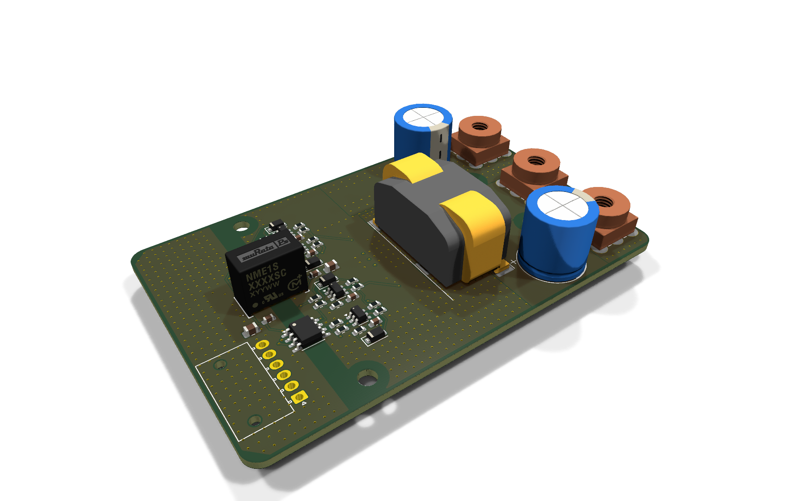
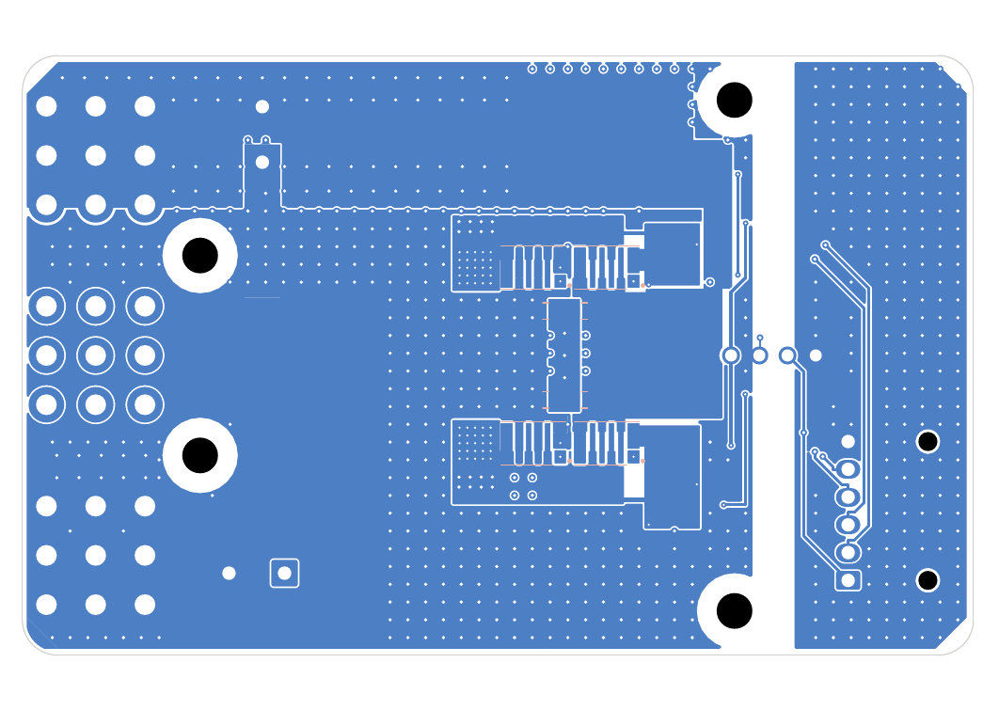
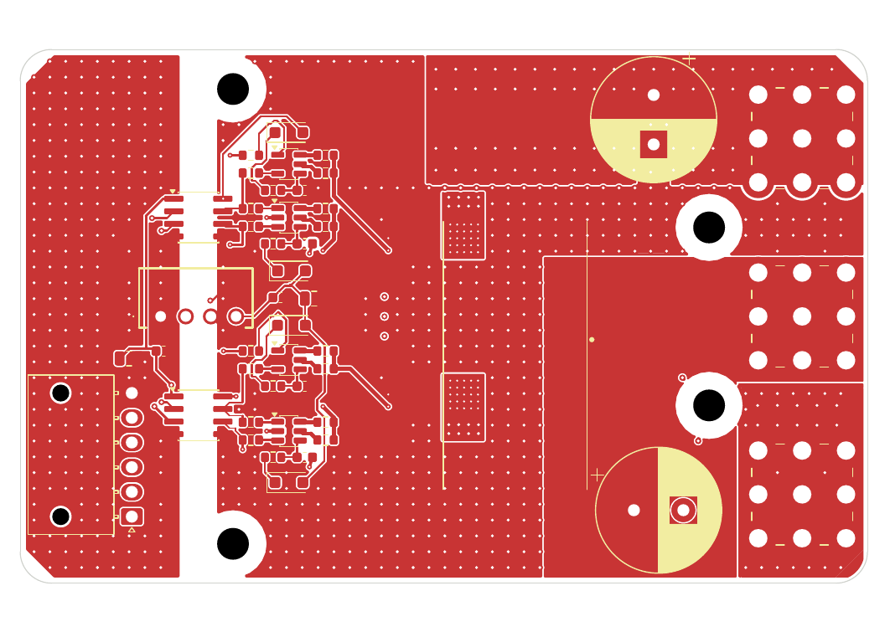
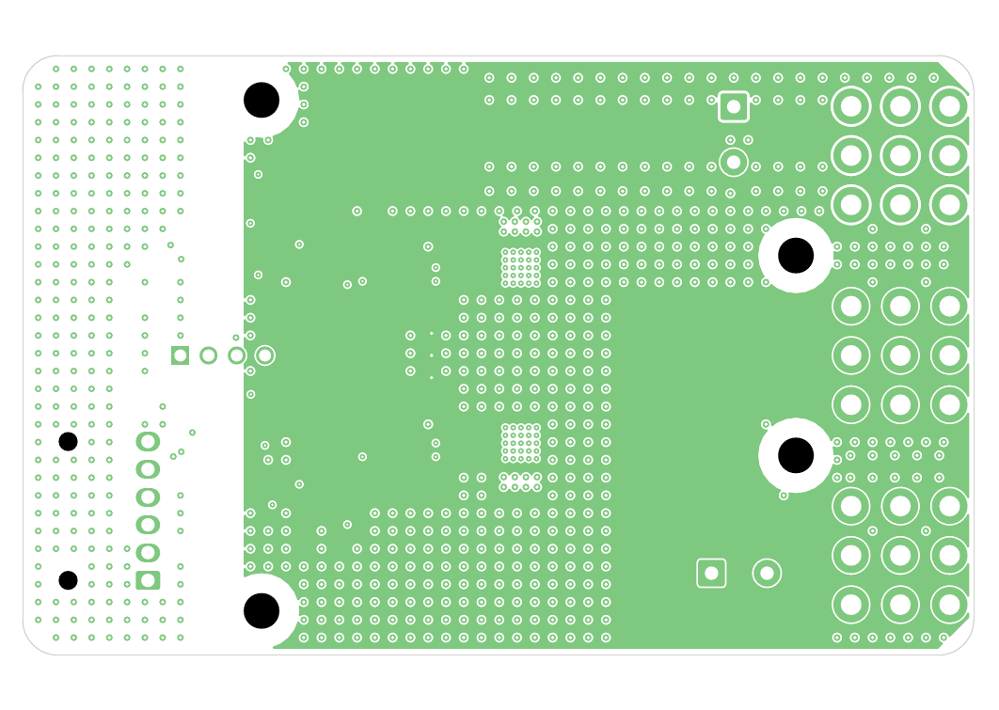

# Power module board (`kicad/PowerModule`)

A separate KiCad project that holds **only the power stage** of the ECE 533 report design, driven
through a control connector. It is the report's module, laid out on the credit-card board. The main
board (`kicad/ECE533_Guide`, Stages 1–5) is a different project and is not affected.

| | |
|---|---|
| Schematic | Base files from the report (commit `57d8ca5`): `PowerModule.kicad_sch` (power stage) + `gate_drive.kicad_sch`. The circuit is unchanged (see §2) |
| Board | 85.60 × 53.98 mm ID-1 (R3.18), 4 × 2 oz, 1.6 mm, ENIG, JLCPCB 4-layer |
| Parts | 54, the same parts as the report: 4 × EPC2304, ERUC23-3R2K, 4 × 1EDN7550B, 2 × SI86S620BC, NME1S0505SC, REDCUBE terminals |
| Checks | ERC: 0 errors, 6 warnings (off-grid wire ends in the base drawing). DRC with schematic parity: **0 violations, 0 unconnected, 0 parity issues** |
| Scripts | `kicad/tools/pm_assign.py`, `pm_flags.py`, `pm_build.py`, `pm_route.py`, `pm_bom.py` (see §8) |



## 1. What the module does
- 72 V in (J1 DC+, J3 DC−), 24 V / 46 A out (J2, return through J3), two phases 180° apart and one
  coupled inductor. No controller on board.
- **J4 (Molex Nano-Fit 105313-1206)** brings in the four gate commands and their 5 V supply:

| J4 pin | Net | Function |
|---|---|---|
| 1 | +5V | 5 V for the isolator inputs and PS1 (the module draws < 0.1 W, PS1 is rated 1 W) |
| 2 | AT1 A1 | Phase 1 low side (Q4 on when high) |
| 3 | AT1 A2 | Phase 1 high side (Q3 on when high) |
| 4 | AT2 A1 | Phase 2 low side (Q5 on when high) |
| 5 | AT2 A2 | Phase 2 high side (Q6 on when high) |
| 6 | GND | Control ground (isolated from the power ground) |

  Each isolator output pair feeds the two drivers of a phase crosswise (B1 → U1 IN−/U2 IN+, B2 →
  U1 IN+/U2 IN−), so **both inputs high or both low turns both FETs off**. Dead time is set by the
  external controller.
- Isolation: AT1/AT2 (SI86S620BC) carry the commands, PS1 (NME1S0505SC) makes the isolated
  +5V_iso / GNDPWR supply for the driver side. The barrier band is x = 16.3–19.7 mm on every layer,
  with a 2.5 mm DRC rule between the J4-side nets and the rest.

## 2. Schematic changes (minimal)
The base schematic is used as given. The only additions are:
1. **Footprints, catalog values and part numbers** (`pm_assign.py`). Every passive is 0603 or
   larger, and the values follow the BOM:
   - C1–C4: 2.2 µF (base: 2.5 µF);
   - C5/C6: EGXF 110 µF each (base: C6 440 µF; per the Stage 2 decision);
   - R13/R14/R19/R20: 5.6 Ω (base: 6 Ω).
2. **`SHIELD` label** joining the two centre taps (C1/C2 and C3/C4). This is the interstitial-shield
   return terminal described in the report (p. 18).
3. **PWR_FLAGs** on the driver supply nets, which come in through J4, PS1 and the bootstrap parts.
4. `connectors.kicad_sch` was dropped: it was in the base folder but not in the hierarchy.

EPC2304 uses the base SamacSys 15-pin symbol. The new footprint `EPC2304_QFN-7_3x5mm_15pin` has the
EPC copper, mask and stencil drawing, with pins 8–15 stacked on the matching physical pad: G → 1/12,
SK → 2/15, D → 3/8, 5/9, 7/10/11, S → 4/13, 6/14.

## 3. Stack-up and layer use (two planes, as in the report)
| Layer | Report equivalent | Use |
|---|---|---|
| L1 (top, 70 µm) | 1st Cu plane | Inductor, drivers, isolators, PS1, bulk caps, terminals. VOUT plane (inductor → J2, C5), VBUS strip (C6, J1), switch-node pads, gate traces, PGND fill on the power side, GND fill on the J4 side |
| L2 (70 µm) | Interstitial shield | Continuous `SHIELD` plane on the power side, with antipads at every feedthrough. No traces |
| L3 (70 µm) | Interstitial shield | Second copy of the shield, 0.1 mm above the FET plane (closest to the dv/dt source). No traces |
| L4 (bottom, 70 µm) | 2nd Cu plane (MOSFET side) | EPC2304s and input ceramics; patterned VBUS / SW / PGND combs, centre-tap island, Kelvin islands, PGND return to J3 |

The report's alumina stack (70 µm / shield / 70 µm) becomes FR-4 3313 prepreg (0.1 mm) on each side
of a 1.1 mm core. L2 and L3 are set as plane layers, so the router never puts traces on them.
**Deviation:** the user's answer allowed L3 to be "empty (or ground)". I used it as a second shield
layer, because it sits right next to the switch nodes. If you want L3 empty, delete its zone.

## 4. Layout, following the report (pp. 20–25)

*L4 from below (mirrored): the two half-bridges, combs and centre-tap island.*

- **Order, left to right** (report figures "Gate Isolator…" and "Gate and power terminals"): J4 on
  the side, AT1/AT2 with PS1 between them, a column of four gate drivers, the 2 × 2 FET block, the
  coupled inductor, then the bulk capacitors and the terminals. The report brings its power wires
  out of the top. Here they land on REDCUBE M4 terminals on the right edge: DC+ top, VOUT middle,
  DC− bottom.
- **FET block** (bottom, at x 33.0 / 39.6 and y 19.1 / 34.9). Each phase is one row: HS left, LS
  right, strips vertical, gate pads toward the drivers. The rows sit exactly under the inductor's
  switch-node pads (pad pitch 15.8 mm), so the phases are copies of each other.
- **Patterned 2nd plane (L4), per phase:**
  - Switch-node comb along the outer ends of the strips (HS sources + LS drains), straight under the
    inductor pad, with 25 filled vias in the pad and 8 more in the band (0.06 mΩ, < 3 % of RDS(on)).
  - VBUS comb (HS drains) and PGND comb (LS sources) along the inner ends.
  - C1 + C2 (C3 + C4) in series bridge VBUS → SHIELD → PGND right at the FETs, so the commutation
    loop is cap → HS → switch node → LS → cap. That loop is about 6.6 × 5 mm, flat, 0.1 mm above the
    L3 shield.
  - The centre taps of both phases form one `SHIELD` island between the rows, stitched to L2/L3.
    That is the shield's single return terminal (report p. 18).
- **Gate drive:**
  - The drivers are on the top, in the report's column left of the FETs.
  - Gate pads and the LS Kelvin pads go up through filled via-in-pad.
  - Each HS driver sits over a **Kelvin island** on L4. The island connects to the HS SK pad and joins
    the switch node only once, at a tie next to the FET. It is the driver's reference and the return
    under its gate trace.
  - Trace lengths: HS 3.8–4.7 mm, LS 8.9–11.9 mm. The LS FET is the far one in each row, as in the
    report's gate-trace figure.
- **Input path:** J1 → VBUS strip (L1 + L4 along the top edge, C6 on a PGND tongue) → VBUS column
  down the left of the FET block → the HS combs. **Output path:** inductor pads → L1 VOUT plane → J2,
  with C5. **Return:** L4 PGND under the inductor → J3.

| L1 (1st Cu plane) | L2 (shield) |
|---|---|
|  |  |

## 5. Mechanics and thermal
- Z60-12.7B on the bottom at x 19–79 mm: flush with neither edge, 3 mm overhang top and bottom.
  There is a 3.0 mm pedestal over the FET block and an insulating TIM (HS and LS share the
  heatsink), drawn on Dwgs.User / B.Fab.
- **4 × M3 holes** (NPTH, 3.4 mm copper keep-out): (21.5, 4.0), (21.5, 50.0), (69.6, 18.0),
  (69.6, 36.0) mm. Screw heads stay clear of the top parts.
- Only the FETs and C1–C4 are on the bottom. THT leads under the heatsink (C5, C6, PS1 pins 3–4,
  J1–J3) must be trimmed to ≤ 2.5 mm (pedestal 3.0 mm).
- FET losses, junction temperature and fan: unchanged from `thermal.md`.

## 6. Current and copper
| Path | Copper | Estimate |
|---|---|---|
| Switch node → inductor, per phase | L4 band + 33 vias + L1 pad | 0.06 mΩ (vias), 23 A |
| VOUT, inductor → J2 | L1 plane ≥ 12.6 mm wide, about 25 mm long | ≈ 0.45 mΩ → 0.9 W at 46 A (one layer) |
| PGND return → J3 | L4 plane ≥ 10 mm wide + L1 fill | ≈ 0.4 mΩ |
| VBUS column (narrowest part) | L4, 2.6 mm × 7.3 mm beside the HS1 Kelvin island | 0.69 mΩ → 0.22 W at 17.9 A |
These are DC estimates (ρ = 1.72 × 10⁻⁸ Ω·m, 70 µm). Stage 1 asked for ≥ 20 mm of VOUT copper on
two layers. This module has one VOUT layer (the report's two-plane scheme puts PGND under it), so it
runs warmer than the main board. See §7.

## 7. Open issues and deviations
1. **VOUT on one layer, VBUS neck 2.6 mm:** expect roughly 20–30 °C of copper rise at 46 A with no
   airflow. Options: thicker copper, or VOUT on L4 as well with PGND moved to L1.
2. **Commutation-loop inductance:** not extracted. A flat lateral loop of about 33 mm², 0.1 mm over
   the shield, should be a few nH, against the report's 10.8 nH. Confirm with Q3D/FastHenry before
   building. The series centre-tapped caps (base schematic) give only 1.1 µF per phase. Consider
   additional ceramics if overshoot is high.
3. **1EDN7550B high side:** Stage 1 judged its static common-mode range marginal at a 79 V high side.
   This is why the main board moved to the Si8274. Kept here because the module reproduces the report.
4. **PS1 SIP-4 pitch** across the barrier: same issue as the main board. A DRC exception allows 0.9 mm
   between the pins and 1.5 mm for copper entering PS1 (≈ 1.4 mm needed for functional isolation
   at ≤ 80 V, PD2).
5. **LS gate loop** is longer than the HS one (layout of the report). There is no gate pull-down in
   the base schematic.
6. The LS Kelvin return runs on L1 and joins PGND through the fill.
7. Stock: the Digi-Key numbers come from the main BOM where the part is shared. The 1EDN7550BXTSA1
   Digi-Key PN and its stock still need to be confirmed.
8. J4 has no 3D model in KiCad's library (renders as an outline).

## 8. Regenerating
Run each command with KiCad's Python (`C:\Program Files\KiCad\10.0\bin\python.exe`) from `kicad/tools`.
```
python pm_assign.py ; python pm_flags.py            # once, on the base sheets (already applied)
kicad-cli sch export netlist -o pm.net ../PowerModule/PowerModule.kicad_sch
python pm_build.py pm.net                            # board, outline, stack-up, placement
python pm_route.py power                             # report pours, vias, Kelvin islands, hops
python pm_route.py signals <freerouting.exe> <dir>   # Freerouting v2.4.1 for the signals
python pm_route.py finish                            # ground fills, stitching
python pm_bom.py pm.net ../../bom/PowerModule_BOM.csv
```
Freerouting is not deterministic. After a rerun, check DRC again; the committed board is the
checked one.
